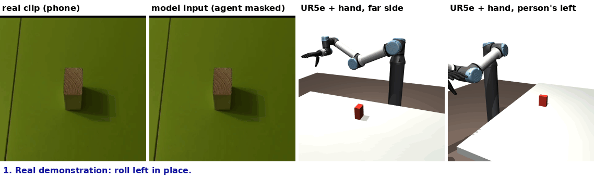
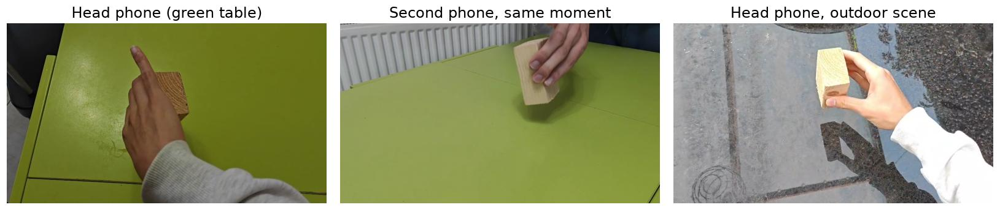
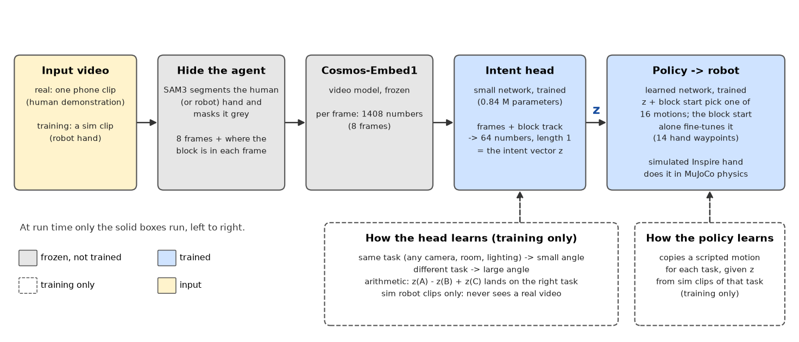
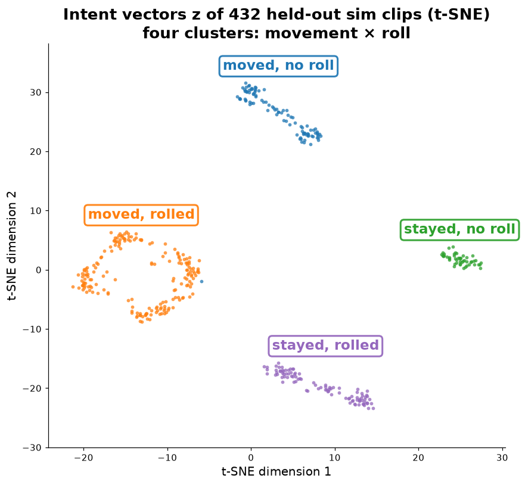
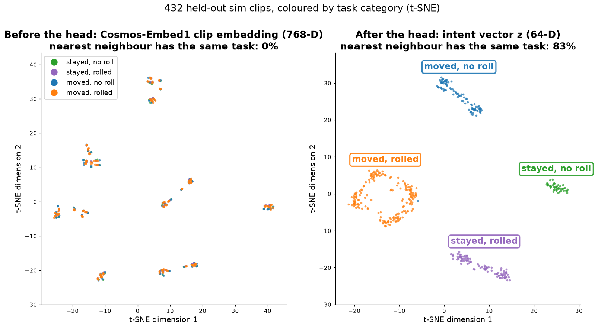
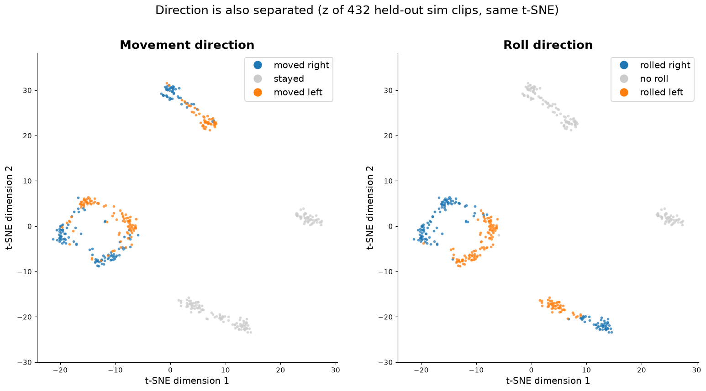
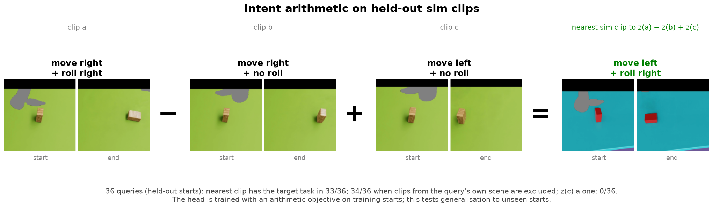
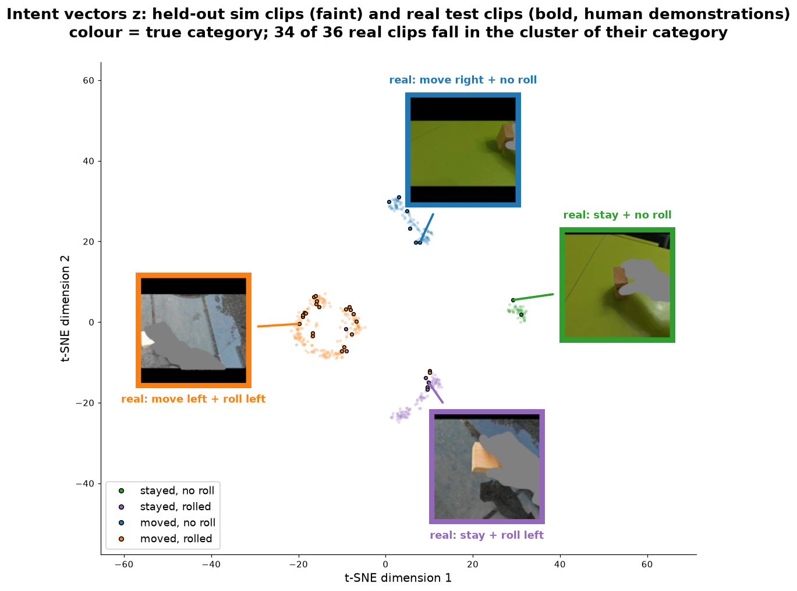
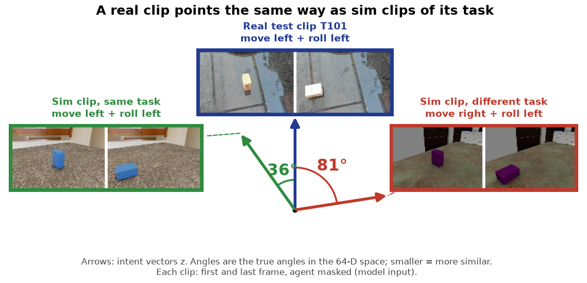
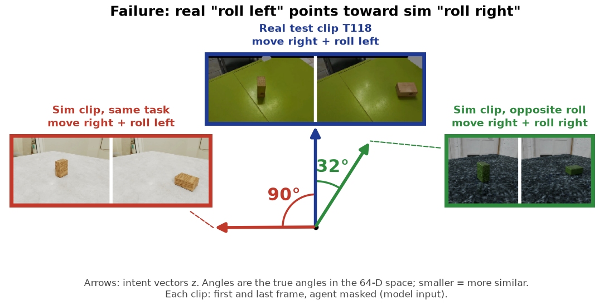

# Learning Task Intent from Multi-View Video

**Can a robot trained only in simulation infer *what* was done to an object from video, without observing *how* it was done, and generalise to real human demonstrations?**



## Overview

- **Input:** multi-view video of a block being moved, with the agent (person or robot hand) masked out.
- **Model:** frozen Cosmos-Embed1 + a small trained head → 64-D intent vector *z*.
- **Action:** a learned policy turns *z* into a motion for a simulated 5-finger hand (MuJoCo).
- **Tasks:** 9 = move {left, stay, right} × roll {left, none, right}.
- **Training:** sim only. **Evaluation:** held-out sim and real human demonstrations.

## Own data



- **Recorded by the author:** 34 two-phone takes of one wooden block, one task per take. 16 development takes guided design choices; 18 test takes, recorded after the system was frozen, measure transfer (5 in an outdoor scene absent from training).
- **Role:** never trained on. Each real clip is encoded to *z* and drives the simulated hand, which measures sim-to-real transfer.
- **Sim design:** the block, camera placement, cropping and robot grip match the recordings.

Details: [docs/own_data.md](docs/own_data.md).

## Architecture



- **Agent masking (SAM3):** human and robot clips differ only in a grey silhouette. This closes the embodiment gap.
- **Head (0.84 M parameters):** per-frame Cosmos features and a 2D block track are mapped to *z*, with unit length.
- **Head losses:**
  - contrastive loss: same task → small angle
  - arithmetic loss: z(a) − z(b) + z(c) → target task
- **Policy:** *z* and the block start select one of 16 motion bins. The start alone sets the fine offset. The output is 14 hand waypoints, executed in physics.

## Structure of the intent space



- **Data:** t-SNE of *z* for 432 held-out sim clips (54 episodes × 8 views).
- **Result:** four clusters, moved/stayed × rolled/not rolled.

### Before and after the head



- **Cosmos-Embed1 alone:** the nearest neighbour shares the task in 0% of clips and the scene in 100%.
- **Intent vector *z*:** the nearest neighbour shares the task in 83% of clips and the scene in 3%.
- **Effect:** the head turns a scene-dominated embedding into a task-dominated one.

### Direction



- Within each cluster, movement direction and roll direction are also separated (sim).

## Intent arithmetic



- **Operation:** remove one task component and add another.
- **Accuracy:** 33/36 held-out queries return a nearest clip with the target task.
- **Scene-excluded check:** 34/36 when clips from the query's own scene are excluded.
- **Baseline:** *z*(c) alone gives 0/36.
- **Note:** the head is trained with this objective on training starts. These results test generalisation to unseen starts.

## Transfer to real demonstrations



- **Data:** 36 real test clips (18 takes × 2 phones), never used in training.
- **Result:** 34/36 fall in the cluster of their category.
- **Unseen scene:** includes 5 takes from an outdoor scene absent from training.

### Vector comparison



- **Same task:** 36° between the real clip and a sim clip of the same task.
- **Different task:** 81° to a sim clip of a different task.
- **Drawing:** the angles are the true angles between the 64-D vectors. A 2D PCA would distort them (36° would shrink to a few degrees).

## Results summary

Policy task success (%), mean over 3 head seeds (range):

| Evaluation set | Success |
|---|---|
| Sim, held-out starts (432 clips) | 85 (85–85) |
| Intent arithmetic (36 queries) | 98 (97–100) |
| Real development set (16 takes, 32 clips) | 64 (59–69) |
| Real test set (18 takes, 36 clips) | 44 (36–53) |
| Chance | 11 |

Real test set, per question (outcome correct, %): did it move 90 · which way 71 · did it roll 100 · which way it rolled 52.

- **Pre-registered system:** frozen before recording, it scored 39% on the real test set.
- **Final system:** chosen afterwards on non-test data only. Its 44% is reported post hoc.

## Limitations

### 1. Strong on held-out sim, weaker on real video

- **Held-out sim test set** (432 clips, unseen block starts): 85% task success.
- **Real test set** (36 clips, 18 takes): 44% task success; chance is 11%.
- **Why:** the head and the policy train on sim clips only; real clips are used only for evaluation.

### 2. Roll direction on real video is at chance



- **Example:** real "roll left" lies closer to sim "roll right" (32°) than to sim "roll left" (90°).
- **Real test set:** whether the block rolled is 100% correct; which way it rolled is 52%, chance level.
- **Likely causes (not isolated):**
  - in 8 masked, low-resolution frames, a left and a right roll of a small block look alike
  - in sim, the robot's grip gives the direction away

### 3. Narrow setup

- One block and 9 discrete tasks: a 15 cm move left/right or none, a quarter-turn roll left/right or none.
- For real clips, the block starts from one fixed position in sim. The hand executes its waypoints open loop, without feedback.
- Real data: one demonstrator, two scenes, 34 takes.

Other approaches tried, with their results: [docs/tried_and_dropped.md](docs/tried_and_dropped.md).

## Future work

- **Roll direction:** more frames and higher resolution around the turn.
- **Sim-to-real:** more varied sim appearance; adding real clips to head training has not helped so far (real test set, nearest-clip readout: 47% → 35%).
- **Richer tasks:** continuous goals instead of 9 categories, other objects, a closed-loop policy.
- **Embodiment:** the same intent vector driving the hand mounted on an arm.

## Running on new recordings

- **Guide:** [docs/own_recordings.md](docs/own_recordings.md), with step-by-step recording, file layout, commands and expected output.
- **Requirements:** the trained weights in `weights/` (9 MB). The sim training set and the original recordings are not needed.
- **Output:** for each clip, the demonstrated task, the task the simulated hand performed and success.

## Reproduce

Tested on an aarch64 NVIDIA DGX Spark (GB10, CUDA 13), Python 3.12, [uv](https://docs.astral.sh/uv/).

| Step | Command | Time |
|---|---|---|
| Setup (3 venvs, hand model, HDRIs) | `bash scripts/setup.sh` | downloads |
| Build the sim training set | `bash scripts/build_sim.sh` | ~2.5 h |
| Sync two-phone takes | `.venv-spider/bin/python -m handsoff.real.prepare sync --raw RAW --review DIR` | ~5 s per take |
| Mask, crop, embed takes | `bash scripts/prepare_real.sh ...` (see header) | ~1 min per take |
| Train and evaluate (plans, head, policy; 3 seeds) | `bash scripts/train.sh` | ~15 min |
| Test on new recordings ([guide](docs/own_recordings.md)) | `bash scripts/run_test.sh RAW` | ~1 min per take |
| Unit tests | `.venv-spider/bin/python -m unittest discover -s tests -t .` | 2 s |

Each script runs detached, writes a log and stops at the first failed step. `python -m handsoff.checks` checks each dataset against the setup described here before the GPU steps.

- **Reproducibility check:** a fresh run of `scripts/train.sh` and the evaluation steps of `WEIGHTS=results/final scripts/run_test.sh` reproduce every reported physics outcome, for all 3 seeds: 432 sim clips, 36 arithmetic queries, 32 development clips and 36 test clips per seed. Trained head weights are bit-identical.
- **Data:** `scripts/build_sim.sh` rebuilds the sim training set. The real recordings are not published, so the development and test rows need them; every other row runs without them.

## Repository map

```
handsoff/
  sim/     scene.py (MuJoCo scene) · primitive.py (the 9 robot motions) · grip.py (grasp search)
           dataset.py (sim training set) · render.py, geometry.py (cameras, masks) · ovrtx.py, photoreal.py (RTX looks)
  real/    sync.py (two-phone audio sync) · sam3.py (masks, block) · framing.py (crop, shared with sim)
           prepare.py (takes → model inputs) · cosmos.py (Cosmos transfer) · review_gate.py (human approval gate)
  model/   embed.py (Cosmos-Embed1) · head.py (intent head) · tasks.py (9 tasks, composition) · data.py
           train.py (head training) · arithmetic.py (composition examples)
  policy/  plans.py (teacher waypoints, physics execution) · policy.py (z + start → motion; embed, train, eval)
  checks.py data checks run by the scripts
weights/   trained head and policy (seed 0), sim scene settings: all that scripts/run_test.sh needs
scripts/   one shell script per stage
config/    grip parameters, confirmed labels, Cosmos review log, track-noise models
tests/     unit tests: robot geometry and grip, task composition, trainer leakage and resume, policy, approval gate
docs/      own_data.md (how the real data was recorded and used) · tried_and_dropped.md (approaches tried, with results)
           own_recordings.md (guide for new recordings) · media/
```
