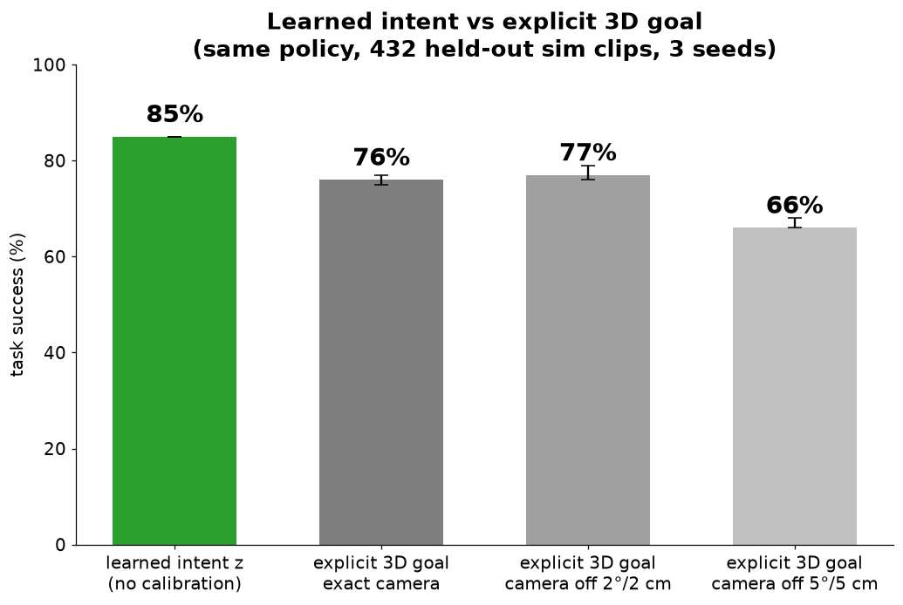
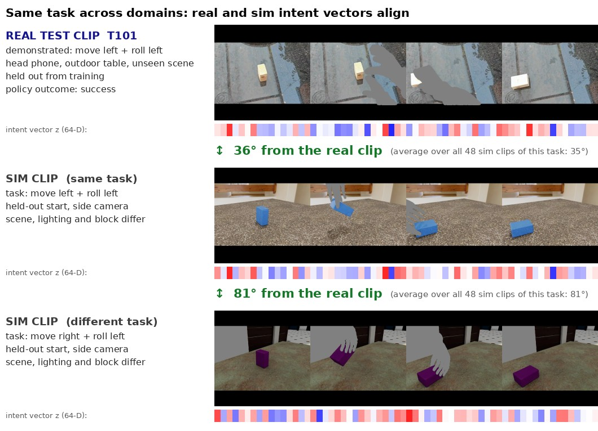
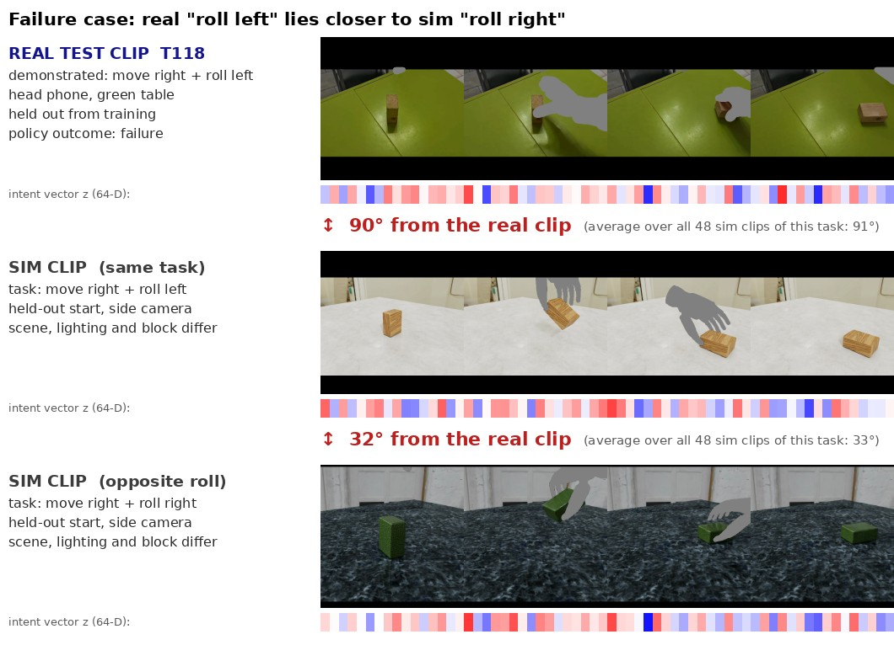

# Hands Off: Learning Task Intent from Agent-Masked Video

**Can a robot infer *what* was done to an object from video, without observing *how* it was done?**


<sub>Development take D15, head phone. The agent is masked before encoding. Robot panels: photoreal render of the inferred task in simulation.</sub>

## Overview

- **Input:** phone video of a person moving a wooden block. The person is masked out of every frame.
- **Representation:** a frozen video model (Cosmos-Embed1) and a small trained head map each clip to a 64-D intent vector *z*.
- **Action:** a learned policy maps *z* to a grasp-carry-turn-place motion for a simulated 5-finger Inspire hand (MuJoCo).
- **Tasks:** 9, from move {left, stay, right} × roll {left, none, right}.
- **Training data:** simulation only.
- **Real data:** real clips drive the robot at run time. 16 development takes guided every design decision. 18 later takes form the test set.

## Architecture


- **Agent masking (SAM3):** human and robot clips differ only in a grey silhouette. This closes the embodiment gap.
- **Head (0.84 M parameters):** per-frame Cosmos features and a 2D block track are mapped to *z*, with unit length.
- **Head losses:**
  - contrastive loss: same task → small angle
  - arithmetic loss: z(a) − z(b) + z(c) → target task
- **Policy:** *z* and the block start select one of 16 motion bins. The start alone sets the fine offset. The output is 14 hand waypoints, executed in physics.

## Learned intent vs explicit 3D goal



- **Setup:** same policy, same 432 held-out sim clips.
- **Explicit baseline:** the block's goal is measured from the video. The 2D track is lifted to the table plane with the camera calibration.
- **Learned *z*:** 85% success, with no calibration.
- **Explicit goal:** 76% with an exact camera, 66% with a 5 cm / 5° camera error.
- **Trade-off:** the explicit goal is better on movement (99 vs 88%) and worse on roll direction (67 vs 94%).
- **Caveat:** in sim, the roll-direction accuracy of *z* is partly due to a visual cue in the robot's grip. It does not carry over to real clips (see [Failure case](#failure-case-roll-direction-on-real-video)).

## Structure of the intent space


- **Data:** t-SNE of *z* for 432 held-out sim clips (54 episodes × 8 views).
- **Result:** four clusters, moved/stayed × rolled/not rolled.

### Before and after the head


- **Cosmos-Embed1 alone:** the nearest neighbour shares the task in 0% of clips and the scene in 100%.
- **Intent vector *z*:** the nearest neighbour shares the task in 83% of clips and the scene in 3%.
- **Effect:** the head turns a scene-dominated embedding into a task-dominated one.

### Direction


- Within each cluster, movement direction and roll direction are also separated (sim).

## Intent arithmetic


- **Operation:** remove one task component and add another.
- **Accuracy:** 33/36 held-out queries return a nearest clip with the target task.
- **Scene-excluded check:** 34/36 when clips from the query's own scene are excluded.
- **Baseline:** *z*(c) alone gives 0/36.
- **Note:** the head is trained with this objective on training starts. These results test generalisation to unseen starts.

## Transfer to real demonstrations


- **Data:** 36 real test clips (18 takes × 2 phones), never used in training.
- **Result:** 34/36 fall in the cluster of their category.
- **Unseen scene:** includes 5 takes from an outdoor scene absent from training.

### Vector comparison



- **Same task:** a real clip lies 36° from a sim clip of the same task.
- **Different task:** it lies 81° from a sim clip of a different task.

## Failure case: roll direction on real video



- **Example:** real "roll left" lies closer to sim "roll right" (32°) than to sim "roll left" (90°).
- **On real clips:**
  - rolled vs not rolled: 100%
  - roll direction: 48–52%, chance level
- **Likely causes (not isolated):**
  - in 8 masked, low-resolution frames, a left and a right roll of a small block look alike
  - in sim, the robot's grip gives the direction away

## Results summary

Policy task success (%), mean over 3 head seeds (range):

| Evaluation set | Success |
|---|---|
| Sim, held-out starts (432 clips) | 85 (85–85) |
| Intent arithmetic (36 queries) | 98 (97–100) |
| Real development set (16 takes, 32 clips) | 64 (59–69) |
| Real test set (18 takes, 36 clips) | 44 (36–53) |
| Chance | 11 |

Real test set, per question (outcome correct, %): did it move 90 · which way 71 · did it roll 100 · which way it rolled 52.

- **Pre-registered system:** frozen before recording, it scored 39% on the real test set.
- **Final system:** chosen afterwards on non-test data only. Its 44% is reported post hoc.

## What did not help

- **Training the head on real clips:** on the test set, sim-only scored 47% and sim + real scored 35% (nearest-clip readout).
- **Cosmos-transferred real clips:** they did not improve held-out real takes, and they weakened sim arithmetic.

## Running on new recordings

- **Guide:** [docs/own_recordings.md](docs/own_recordings.md), with step-by-step recording, file layout, commands and expected output.
- **Requirements:** the trained weights in `weights/` (9 MB). The sim training set and the original recordings are not needed.
- **Output:** for each clip, the demonstrated task, the task the simulated hand performed and success.

## Reproduce

Tested on an aarch64 NVIDIA DGX Spark (GB10, CUDA 13), Python 3.12, [uv](https://docs.astral.sh/uv/).

| Step | Command | Time |
|---|---|---|
| Setup (3 venvs, hand model, HDRIs) | `bash scripts/setup.sh` | downloads |
| Build the sim training set | `bash scripts/build_sim.sh` | ~2.5 h |
| Sync two-phone takes | `.venv-spider/bin/python -m handsoff.real.prepare sync --raw RAW --review DIR` | ~5 s per take |
| Mask, crop, embed takes | `bash scripts/prepare_real.sh ...` (see header) | ~1 min per take |
| Train and evaluate (plans, head, policy; 3 seeds) | `bash scripts/train.sh` | ~15 min |
| Test on new recordings ([guide](docs/own_recordings.md)) | `bash scripts/run_test.sh RAW` | ~1 min per take |
| Unit tests | `.venv-spider/bin/python -m unittest discover -s tests -t .` | 2 s |

Each script runs detached, writes a log and stops at the first failed step. `python -m handsoff.rules` checks a dataset against the design rules (`docs/decisions.md`) before training.

- **Reproducibility check:** a fresh run of `scripts/train.sh` and the evaluation steps of `WEIGHTS=results/final scripts/run_test.sh` reproduce every reported physics outcome, for all 3 seeds: 432 sim clips, 36 arithmetic queries, 32 development clips and 36 test clips per seed. Trained head weights are bit-identical.
- **Data:** `scripts/build_sim.sh` rebuilds the sim training set. The real recordings are not published, so the development and test rows need them; every other row runs without them.

## Repository map

```
handsoff/
  sim/     scene.py (MuJoCo scene) · primitive.py (the 9 robot motions) · grip.py (grasp search)
           dataset.py (sim training set) · render.py, geometry.py (cameras, masks) · ovrtx.py, photoreal.py (RTX looks)
  real/    sync.py (two-phone audio sync) · sam3.py (masks, block) · framing.py (crop, shared with sim)
           prepare.py (takes → model inputs) · cosmos.py (Cosmos transfer) · review_gate.py (human approval gate)
  model/   embed.py (Cosmos-Embed1) · head.py (intent head) · tasks.py (9 tasks, composition) · data.py
           train.py (head training) · arithmetic.py (composition examples)
  policy/  plans.py (teacher waypoints, physics execution) · policy.py (z + start → motion; embed, train, eval)
  rules.py automatic checks of the design rules
weights/   trained head and policy (seed 0), sim scene settings: all that scripts/run_test.sh needs
scripts/   one shell script per stage
config/    grip parameters, confirmed labels, take split, Cosmos review log, track-noise models
tests/     unit tests: robot geometry and grip, task composition, trainer leakage and resume, policy, approval gate
docs/      own_recordings.md (guide for new recordings), decisions.md (design rules and rationale), media/
```
