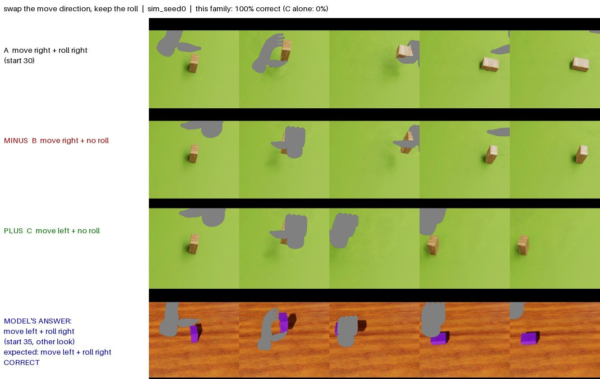
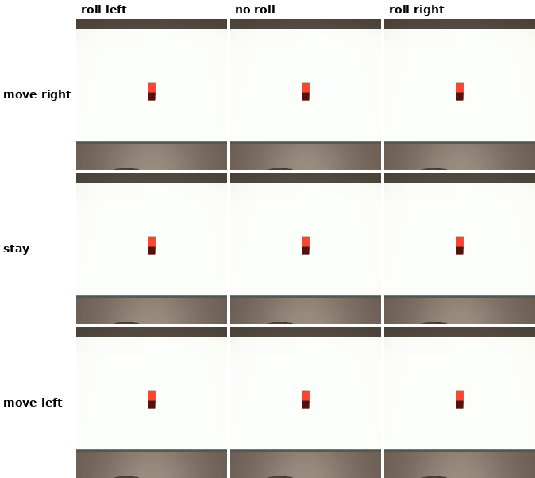
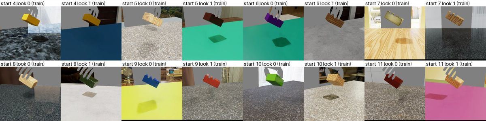

# Hands Off: Learning Task Intent from Multi-View Video

**Can a robot learn *what* you did to an object, without ever seeing *how* you did it?**

I film myself moving a wooden block with two phones and mask myself out of every frame. A model reads the *task* from what happened to the block, and a simulated robot hand does the same task. It never copies my hand motion.


<sub>A training take (D15), read by a model trained only on simulation that never saw a real video. Robot: the simulated Inspire hand doing the chosen task, rendered photoreal. The held-out test on new recordings is below.</sub>

| | |
|---|---|
| **Input** | Two ordinary phone videos (head-mounted + handheld) of a person moving a block |
| **Output** | One of 9 tasks (move left / stay / right × roll left / none / right), executed by a floating 5-finger Inspire hand in MuJoCo |
| **Model** | Frozen [Cosmos-Embed1](https://huggingface.co/nvidia/Cosmos-Embed1-448p) video features + a 1.2 M-parameter head |
| **Training data** | 2,592 photoreal sim clips + 16 of my own takes (32 phone clips + 54 approved Cosmos-Transfer restylings) |
| **Test** | 18 new takes recorded after the models were frozen: **[pending, 13 Oct]** |

## The idea

A human hand and a robot hand look nothing alike, and neither do my kitchen and a simulator. So I **mask the agent out of every frame** (grey silhouette, both for me and for the robot). The model sees only the block, the table and a grey blob. What is left to learn is *what happened to the object*, and that is the same for a human and a robot. Hence "hands off".

The model maps each clip to a 64-d **intent vector** and is trained so that tasks compose:



<sub>"move right + roll right" − "move right" + "move left" → "move left + roll right". The answer is a different start, in a different room and material. Held-out sim starts; `sim_seed0`.</sub>

The 9 tasks the robot hand can execute, from the person's viewpoint (one start and room, rendered photoreal):



## Results

**Held-out test on new recordings** (18 takes, 2 per task type, never trained on and never used to choose anything): **[pending: recorded 13 Oct]**

**Fair test on my own takes** (each of the 16 takes held out in turn; 32 clips; seed 0; % correct):

| model trained on | move + roll both right | move right | roll right |
|---|---|---|---|
| sim only (never saw a real video) | 69 | 91 | 78 |
| sim + my takes | 66 | 88 | 78 |
| sim + my takes + Cosmos restylings | 62 | 84 | 78 |
| chance | 11 | 33 | 33 |

**Task arithmetic** (held-out sim starts, answer from a different look; 12 queries per family × 3 seeds):

| family | example | sim only | sim + takes | + Cosmos | C alone |
|---|---|---|---|---|---|
| remove the move, keep the roll | right+roll − right + stay → roll in place | 97 | 67 | 58 | 0 |
| remove the roll, keep the move | right+roll − roll + stay → right | 100 | 100 | 100 | 0 |
| swap the move direction | right+roll − right + left → left+roll | 100 | 94 | 89 | 0 |

**What these say:**
- **Move left / stay / right transfers from sim to real:** 84–91% on real clips, from a model that never saw one.
- The head is *trained* with arithmetic on the training starts. The table shows that it generalises to new starts and looks, not that it emerges on its own.

## How it works

```
two phones ──► sync by audio ──► SAM3: mask person/hand/arm grey, find the block ──► crop centred on the block
          ──► 8 frames ──► Cosmos-Embed1 (frozen) + 2D block track ──► head ──► z (64-d)
          ──► nearest simulated clip ──► its task ──► Inspire hand picks, carries, turns and places the block
```

1. **Simulation.** 36 random block starts × 9 tasks: a floating Inspire hand does each task with one fixed pick-carry-turn-place motion and a human-like grip. Every episode passes physics checks (no table penetration, gentle release, no twist). Each episode is filmed by 4 phone-like cameras (one where my head is, three random) and rendered photoreal with NVIDIA's RTX renderer (ovrtx), in 72 random rooms and materials:
   
2. **My data.** 16 takes × 2 phones; I confirmed every label by watching both videos. Cosmos-Transfer2.5 restyles each clip (new table colour and sleeve). I watched all 64 generated videos in full and approved 55; 54 of those also pass an automatic check that the block still does the same task.
3. **Training.** Same-task clips from different rooms pull together, two small readouts predict the move and the roll, and A − B + C must land nearest a clip of the composed task. In the real stages, my labelled clips sit with same-task sim clips. Each stage has a fixed epoch count, chosen by leave-one-take-out before the test. There are 3 stages (sim / + takes / + Cosmos) × 3 seeds.
4. **Acting.** The robot's motion is a scripted primitive per task. What is learned is *which task*, from the video.

## What didn't work

- **The roll direction does not transfer to real video.** "Rolled vs upright" is reliable, but for an in-place roll "left vs right" is close to a coin flip (7/14 held-out clips). In sim it is easy. Likely cause (not yet tested): in 8 masked, low-resolution frames of a small block, a left turn and a right turn look nearly the same.
- **My own data did not beat simulation alone.** Adding my 16 labelled takes, and then their Cosmos restylings, did not improve held-out takes (69 → 66 → 62%), and it weakened the sim arithmetic (97 → 67 → 58%). Without labels it was worse: training "both phones of a take must agree" collapsed every real clip to a single task.

## Run it

Tested on an aarch64 NVIDIA DGX Spark (GB10, CUDA 13), Python 3.12, [uv](https://docs.astral.sh/uv/).

| step | command | time |
|---|---|---|
| setup (3 venvs, hand model, HDRIs) | `bash scripts/setup.sh` | downloads |
| build the sim training set | `bash scripts/build_sim.sh` | ~2.5 h |
| sync phone takes for review | `.venv-spider/bin/python -m handsoff.real.prepare sync --raw RAW --review DIR` | ~5 s per take |
| mask, crop, embed the takes | `bash scripts/prepare_real.sh ...` (see header) | ~1 min per take |
| train 9 heads + arithmetic | `bash scripts/train.sh` | ~1.5 h |
| held-out test → robot | `bash scripts/run_test.sh RAW` | ~1 min per take |
| unit tests | `.venv-spider/bin/python -m unittest discover -s tests -t .` | 2 s |

Each script runs detached, writes a log, and stops at the first failed step. `python -m handsoff.rules` checks a dataset against the project's rules (`docs/decisions.md`) before any training.

**[pending: data and model download, recording layout]**

## Repo map

```
handsoff/
  sim/     scene.py (MuJoCo scene) · primitive.py (the 9 robot motions) · grip.py (grasp search)
           dataset.py (sim training set) · render.py, geometry.py (cameras, masks) · ovrtx.py, photoreal.py (RTX looks)
  real/    sync.py (two-phone audio sync) · sam3.py (masks, block) · framing.py (crop, shared with sim)
           prepare.py (takes → model inputs) · cosmos.py (restylings) · review_gate.py (human approval gate)
  model/   embed.py (Cosmos-Embed1) · head.py (intent head) · tasks.py (9 tasks, composition) · data.py
           train.py · choose_epochs.py · evaluate.py (clip → task → robot) · arithmetic.py
  rules.py automatic checks of the design rules
scripts/   one shell script per stage (table above)
config/    grip parameters, confirmed labels, take split, Cosmos review log, track-noise models
tests/     28 unit tests: robot geometry and grip, task composition, trainer leakage and resume, approval gate
docs/      decisions.md (every design rule and why), media/
```
