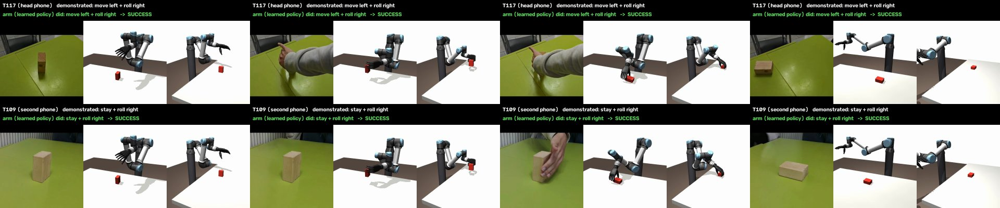

# Hand on a UR5e arm

The policy outputs hand poses, so the same output can drive the Inspire hand mounted on a 6-DOF arm. Nothing is retrained.

## Robot

`assets/ur5e_inspire.xml`, generated by `python -m handsoff.sim.arm export`:

- **One kinematic chain:** UR5e (MuJoCo Menagerie) → flange adapter (Ø63 mm, 10 mm, 50 g) → Inspire right hand.
- **No floating wrist:** the hand's six floating wrist joints are removed.
- **Arm joints:** torque motors limited to the UR5e joint torques (150 / 28 N·m).
- **Base:** a static pedestal on the person's side of the table, where the demonstrator stood.
- **Physics settings:** contact, solver and integrator settings are the floating-hand scene's.

## Controller

The floating wrist is a mass–spring–damper at the hand base (mass 1.48 kg / 1.0 kg·m², stiffness 1000, critical damping). The arm reproduces these dynamics with one task-space law, recomputed every 2 ms:

```
F = Λ [M_f⁻¹ (K e − D v + W) − J̇ q̇] − W,     τ = Jᵀ F + Coriolis
```

- **Λ:** the arm's task-space inertia.
- **e, v:** pose error and velocity of the hand base.
- **W:** the contact wrench on the hand, as a wrist force/torque sensor would measure it.
- **No inverse kinematics during the motion:** IK is solved once, for the start pose.
- **Timing:** the empty-hand transit moves (to and from rest, turning above the block) run 1.5× slower, which keeps every joint below the UR5e's 180°/s.

## Results

Scripted plans, 100 new starts × 9 tasks (floating hand: 100%):

| Arm controller | Base on the person's side | Base on the table |
|---|---|---|
| Joint servos on inverse kinematics of the waypoints | 70% | 73% |
| Same stiffness and damping as the floating wrist | 37% | 99% |
| + floating hand's mass, no force sensing | 100% | 66% |
| **Full floating-wrist dynamics with the contact wrench** | **100%** | **99.7%** |

- **Why the force term:** the arm's own inertia changes how the hand behaves on contact. Only the full version works from both bases.
- **Base placement:** 24 random reachable bases on the person's side succeed on 863/864 episodes.



Full system, policy seed 0: arm vs floating hand.

| Evaluation set | Floating hand | Arm |
|---|---|---|
| Sim, held-out starts (432 clips) | 85% | 85% |
| Intent arithmetic (36 queries) | 97% | 97% |
| Real development set (32 clips) | 62.5% | 62.5% |
| Real test set (36 clips) | 36% | 36% |

- **Clip by clip:** the arm reaches the same success on 536/536 runs, with the final block pose within 0.2 mm. Every failure is a wrong task choice by the policy; none is an execution failure.
- **Limits:** peak joint speed is 137°/s.

Robustness, teacher plans, 50 starts × 9 tasks per condition, floating hand / arm. Grasps searched at the nominal block only (`config/grip_v3.json`) vs under randomised mass and friction (`config/grip_v4.json`, used by the released system):

| Condition | Nominal-block grasps | Searched grasps |
|---|---|---|
| Nominal block (0.12 kg, friction 1.0) | 100 / 100% | 100 / 100% |
| Block mass ×2 (0.24 kg) / friction 1.5 | 100 / 100% | 100 / 100% |
| Block mass ×0.5 (0.06 kg) | 67 / 67% | 100 / 100% |
| Friction 0.6 | 67 / 67% | 100 / 100% |
| 0.04 kg / friction 0.4 / 0.06 kg + friction 0.6 / 0.04 kg + friction 0.4 | 33 / 33% each | 100 / 100% each |
| Arm only: force/torque sensor delay 10 / 20 ms | 100% / 100% | 100% / 100% |
| Arm only: force/torque sensor noise 1 / 2 / 4 N | 100% / 96% / 94% | 100% / 97% / 95% |

- **The arm adds no fragility.** Under every mass and friction change, the arm and the floating hand succeed on the same share of plans.
- **The fragile part was the grasp.** With the nominal-block grasps, every failure is a roll-right or upright task; the searched grasps remove all of them. The arm's only losses are from force/torque sensor noise.
- **Full system with the searched grasps:** the arm and the floating hand reach the same outcome on every clip, for each of the 3 policy seeds.

## Run

```bash
python -m handsoff.policy.policy eval --sim weights/scene.json --plans weights/durations.npz \
    --z Z.npz --policy weights/seed0/policy/policy.pt --robot arm --out results/arm --sets real
```

- `--robot arm` runs the same policy waypoints on the arm; without it, the floating hand runs them (default).
- Requires `external/mujoco_menagerie`, installed by `scripts/setup.sh`.
- Tests: `tests/test_arm.py`.
