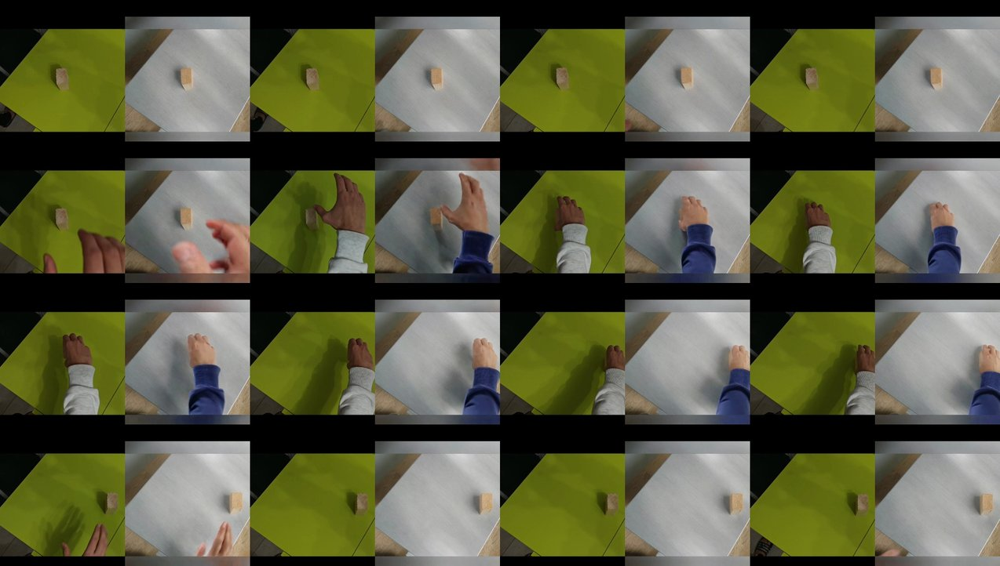
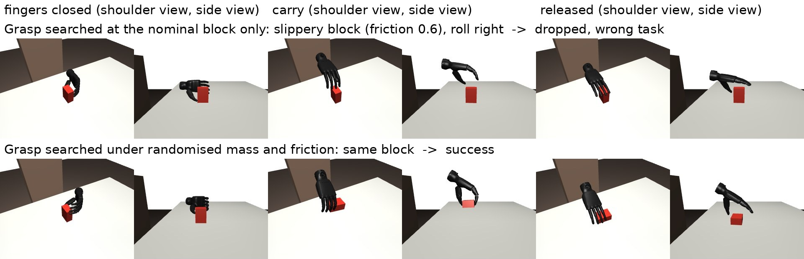
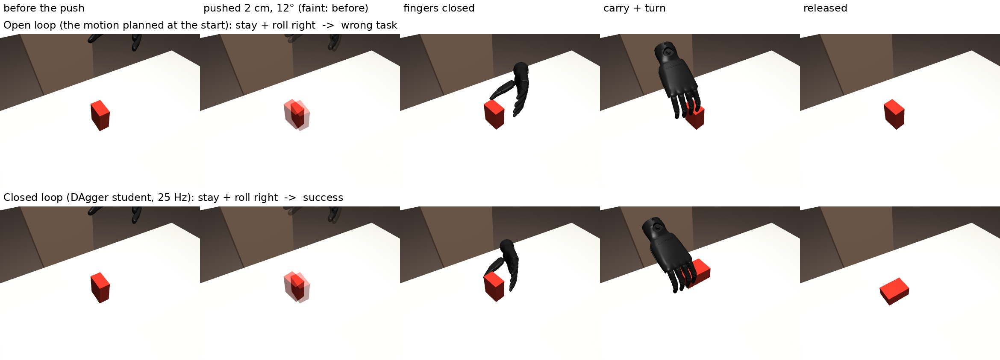

# Tried and dropped

What was tried on the way to the final system, what it gave and why it was dropped or changed. Numbers are task success (%) unless stated. "Development set" = the 16 real development takes (32 clips); "test set" = the 18 real test takes (36 clips).

## Representation

| Tried | Result | Outcome |
|---|---|---|
| Cosmos-Embed1 alone, no trained head | Clips group by camera and scene, not by task (nearest neighbour shares the scene in 100% of clips, the task in 0%) | A trained head is needed |
| Sim looks randomised per episode, every view sharing the same colours | The head matched clips by colour instead of task | Positive pairs now come from two different looks of the same motion |
| Cosmos features without block position | Cosmos loses where the block is: position error 6.7 cm | A 2D block track added as a second input: 2.6 cm |
| 3D block pose from off-the-shelf trackers (FoundationPose, with and without monocular depth) | In sim, a perfect 3D box would raise robot success 52% → 68%, but the trackers lost the block under the head phone's forearm: 31–36% vs 69% with the 2D track | The 2D track stays |
| Plain contrastive loss | *z* worked as a lookup table: similarity falls to ~0 beyond 8 cm, and intent arithmetic hit 3% | An arithmetic loss added to the head |
| Frame order in the head (1D convolution over the 8 frames) | Sim up (other phones +9), development set down (68% → 52%) | Dropped: it fits sim-specific motion |
| DINOv2-large instead of Cosmos-Embed1 | A tie: development set 61% vs 65%, sim other cameras 93% vs 83%; neither reads real roll direction | Cosmos kept by the rule fixed before the run |
| Two auxiliary classifiers and the Cosmos clip vector | Removing both together cost nothing once the policy took its offset from the start alone | Removed (the shipped head) |

## Hiding the agent

The sim model reads roll direction from the robot's grip: frames 0–2 alone, before the block turns, give the direction in 78% of sim clips. Real human clips do not carry this cue.

| Mask fill tried (5 seeds each) | Grip-cue probe (target 50%) | Development set: task / roll direction | Robot, development set |
|---|---|---|---|
| Grey silhouette (kept) | 79 | 68 / 46 | 51 |
| Random-noise fill | 81 | 78 / 64 | 56 |
| Padded grey blob | 85 | 80 / 64 | 54 |
| Shifted image copy, jittered outline (Cloak-style) | 58 | 72 / 57 | 48 |

No fill removed the cue, and the robot gain stayed within the seed spread, so the grey silhouette stays. The likely fix is a grip that rolls both ways, which was searched but dropped the block on roll right.

## Real data in training (controls)

The system trains on sim only; these controls check whether real training data would help.

| Tried | Result | Outcome |
|---|---|---|
| The 16 labelled development takes in head training | Test set 47% (sim only) → 35%; the heads learned the second phone's training position and flipped left/right when it moved | Sim-only training kept |
| Plus 54 Cosmos-transferred versions of the takes | Test set 40%. Some generated videos changed the block's shape or texture, so every generated video needed approval after watching it in full | Not used |
| Unlabelled "both phones must agree" loss on real takes | Every real clip collapsed to "roll left" | Not used |
| Real *z* in policy training | Worse on held-out development takes (−19 points, policy seed 0) | Not adopted |

- **Intent vectors of the Cosmos-transferred clips** (no retraining): same-task clips point the same way (cosine 0.74, other tasks −0.08), but the task readout is 59%, against 62–75% for the real clips. The new looks add appearance variety, not task evidence.

## Policy (z → motion)

| Tried | Result | Outcome |
|---|---|---|
| Nearest sim clip lookup, then a scripted motion | Test set 47% (pre-registered) | Replaced by a learned policy so the motion comes from *z* directly |
| Regression to 14 waypoints | Averages between tasks: test set 33% | Replaced by bins |
| Flow matching (500k steps) | Sim 82%, development set 50%: no better than bins | Not pursued |
| Bins with the offset from *z* and start | Test set 42% (pre-registered system, robot 39%); results depended on the policy seed | Offset now from the start only: development set 38% → 62.5%, test 44% (47% with the grasps searched under randomised physics) |
| PCA or LDA to 8 numbers before the policy | LDA +2.5 on the development set (5 seeds), arithmetic −7 | Not adopted |

## Grasp robustness

The grasps first used were searched at the nominal block only; roll right failed on 68% of held-out light or slippery blocks (0.04–0.3 kg, friction 0.4–1.5). Tried, on roll right, scored on 336 held-out mass × friction cases:

| Tried | Result | Outcome |
|---|---|---|
| Grasp search (cross-entropy method) under randomised mass and friction, open loop | 100% held-out; upright grasp the same way: 64% → 100% | Adopted (`handsoff/sim/grip_robust.py`, `config/grip_v4.json`) |
| PPO residual on the scripted grasp from finger closing (±15 mm, ±0.15 rad), touch-like and block-pose observations, 25 Hz | 63% | Too narrow: the working grasp moves the palm 25 mm and tilts it 0.25 rad before the fingers close |
| PPO residual from the descent (±40 mm, ±0.4 rad, thumb yaw), 3 seeds | 100% / 82% / 0%; one seed tipped the block over instead of lifting it, which still scored for no-move tasks | Seed-unstable |
| Same, no task credit without a lift, 3 seeds | 99% / 94% / 0%; the third seed stopped lifting early in training | Seed-unstable |
| Replay of the best PPO seed's actions without feedback | 94% (live 100%) | Most of what PPO learned is a better fixed grasp, the same kind of fix as the search |

Full system with the adopted grasps (`scripts/robustness.sh`; seed 0, the same *z*; task success %, nominal-block grasps → searched grasps):

| Block | Sim, 432 held-out clips | Real test set, 36 clips |
|---|---|---|
| Nominal (0.12 kg, friction 1.0) | 85 → 85 | 36 → 36 |
| Light (0.06 kg) | 57 → 85 | 19 → 36 |
| Very light, less friction (0.04 kg, 0.8) | 28 → 85 | 3 → 36 |
| Slippery (friction 0.6) | 57 → 85 | 19 → 36 |
| Light and slippery (0.09 kg, 0.5) | 28 → 85 | 3 → 36 |
| Heavy, less friction (0.30 kg, 0.7) | 57 → 85 | 19 → 36 |

All 3 seeds with the searched grasps: 85% sim and 47% real test in every condition. With the nominal-block grasps every loss is a roll-right or upright task; with the searched grasps every remaining failure is a wrong task in *z*.

## Closed loop (experiment, not in the released system)

The open-loop policy fails when the block is moved after the motion was planned: 9% success after a 2–2.7 cm push just before the descent (100% without a push).

| Tried | Result | Outcome |
|---|---|---|
| DAgger student: MLP at 25 Hz, residual on the planned hand pose from the descent to the release; observes the block pose against the plan, contact forces, slip; expert = the scripted plan re-made from the block's current pose; 5 iterations × 1500 episodes with random pushes, mass and friction | Pushed: 72% (roll right 95–97%, roll left 77–78%, upright 48–52%); expert 100%; no push: 100% | Recovers most pushes; the gap to the expert is imitation error, largest for the upright grasp. The student sees clean block pose, so it does not yet earn its keep over the script |

Full system (video → *z* → policy → student, nominal block): pushed sim clips 14% → 54%, pushed real test clips 1% → 19%; without a push the student changes nothing (85% sim, 36% real).

